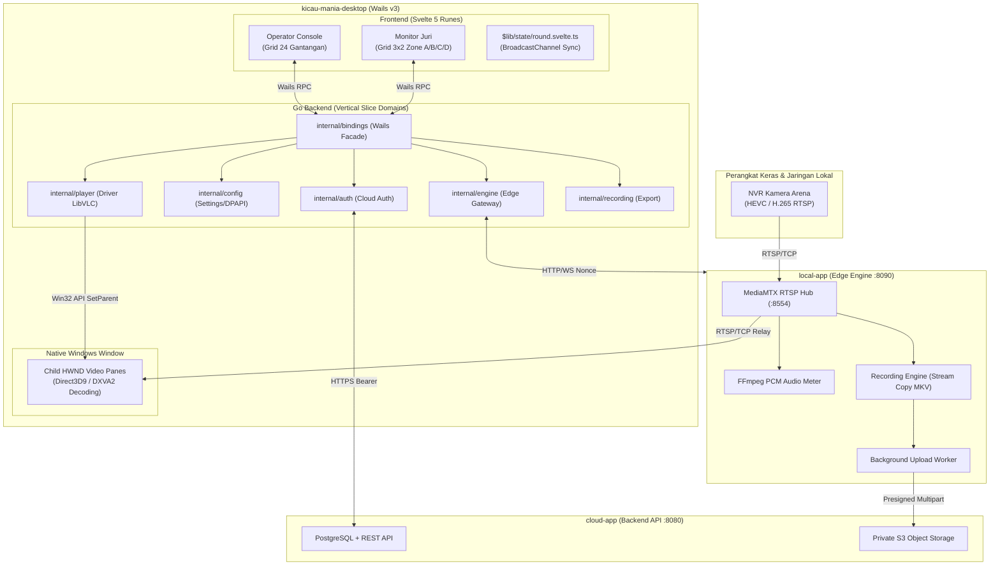

# Arsitektur Kicau Mania Desktop

Dokumen ini menjelaskan arsitektur internal, aliran data, dan integrasi perangkat lunak pada aplikasi `kicau-mania-desktop`.

---

## 1. Diagram Aliran Data & Integrasi

---

## 2. Struktur Modul Go Backend (Vertical Slice)

Setiap domain bisnis di `internal/` berdiri secara mandiri dengan tanggung jawab terfokus:
- **`internal/auth/`**: Mengelola sesi login operator/juri, token refresh aman, dan otorisasi hak akses terhadap cloud-app.
- **`internal/config/`**: Mengelola konfigurasi desktop, validasi URL, dan proteksi rahasia menggunakan Windows DPAPI (`CryptProtectData`).
- **`internal/engine/`**: Mengelola gateway komunikasi ke `local-app` (Edge), pertukaran nonce lokal, dan monitoring preview metrik audio via WebSocket.
- **`internal/player/`**: Mengontrol driver LibVLC dan window handle HWND Win32, kalkulasi koordinat dan clipping viewport saat dialog/modal aktif.
- **`internal/recording/`**: Menangani pengunduhan file rekaman lokal dan penyimpanan sesi otomatis dengan penamaan yang mudah dibaca manusia (*human-readable*).
- **`internal/bindings/`**: Titik integrasi Wails v3 yang mendelegasikan RPC frontend ke masing-masing usecase domain.
- **`internal/container/`**: Composition root yang menginisialisasi dependensi dan menghubungkan usecase dengan driver.

---

## 3. Struktur Frontend (Svelte 5 Runes)

Frontend mengadopsi standar reaktivitas murni Svelte 5 (`$state`, `$derived`, `$effect`, `$props`):
- **`lib/models/`**: Definisi tipe data domain terpusat (`round.model.ts`, `session.model.ts`, `camera.model.ts`, `recording.model.ts`, `config.model.ts`).
- **`lib/components/operator/`**: Dekomposisi Operator Console menjadi sub-komponen single-responsibility:
  - `operator-header.svelte`: Kontrol taktis ronde, dual timer countdown (10m ronde & 150s shift), preset durasi.
  - `grid/gantangan-grid-24.svelte` & `grid/gantangan-card.svelte`: Visualisasi 24 kamera gantangan dan kuadran 3x2.
  - `spotlight/spotlight-view.svelte`: Tampilan zoom kamera tunggal.
  - `modals/quick-save-modal.svelte`: Dialog simpan cepat sesi rekaman.
  - `modals/round-config-modal.svelte`: Formulir edit event, sesi, durasi, dan nama juri.
- **`lib/state/`**: State global tersinkronisasi antar-tab/window via `BroadcastChannel("kicau_round_sync_channel")`.
