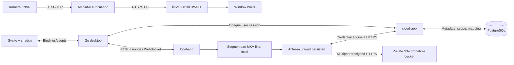

# Arsitektur desktop

Go desktop memegang nonce operator, access/refresh token dan worker player. WebView hanya menerima DTO yang dibutuhkan UI. Pengaturan aktif hanya berubah setelah restart desktop. Scope engine loopback. Playback berkas memakai proxy loopback sementara dengan path acak 256-bit, hanya untuk satu rekaman dan GET/HEAD/Range. Nonce tetap di Go; listener ditutup bersama player.

MediaMTX sudah dimiliki local-app. Go desktop tidak mengakses kredensial RTSP upstream, memakai URL hub lokal yang dibentuk dari channel terdaftar dan sesi RUNNING/DEGRADED. libVLC ditanam ke child HWND dan dikendalikan melalui API DLL, tanpa subprocess mpv. Player/instance VLC dilepas saat panel ditutup. Resize/clipping memperhitungkan DPI; panel disembunyikan ketika dialog menutupinya. Relay tidak mengubah codec. Saving MKV menggunakan stream copy video/audio; decode PCM hanya untuk metrik. Penutupan worker tidak mematikan FFmpeg/MediaMTX engine.

local-app adalah satu-satunya pemilik recording dan antrean upload. Konfigurasi cloud/engine terenkripsi DPAPI dan mapping tersimpan atomik. File final dan manifest lama tidak dipindahkan ke direktori desktop. Worker mengabaikan file belum selesai dan rekaman tanpa mapping. Progres committed parts tersimpan per rekaman; progres bukan estimasi waktu.

Sesi cloud tidak sama dengan sesi perangkat. Snapshot mapping menyimpan identitas tiket, burung dan peserta pada saat konfirmasi. DQ atau perubahan master berikutnya tidak mengalihkan rekaman kepada tiket lain. Pairing ulang pada arena yang sama mengganti secret tanpa membuat engine baru.

Engine hanya menerima NVR HEVC/H.265 dan file MKV. Acceptance: scripts/test-native.ps1 -NVRRTSPURL <NVR_RTSP_URL> beserta binary; sumber NVR nyata wajib tersedia. Unit test logika tetap ada.

Player live memakai sinkronisasi clock libVLC otomatis, tanpa memaksa clock-synchro=0. PLAYING mengikuti kemajuan frame, bukan state VLC saja. Jika frame berhenti 3 detik status STALLED; setelah 10 detik player channel disambung ulang. Startup tanpa frame dibatasi 20 detik. Panel tersembunyi/minimized dipantau melalui decode counter. Watchdog hanya untuk live; file recording tidak diulang otomatis setelah selesai. Tidak ada perubahan codec atau kontrol recording oleh pemulihan player.
